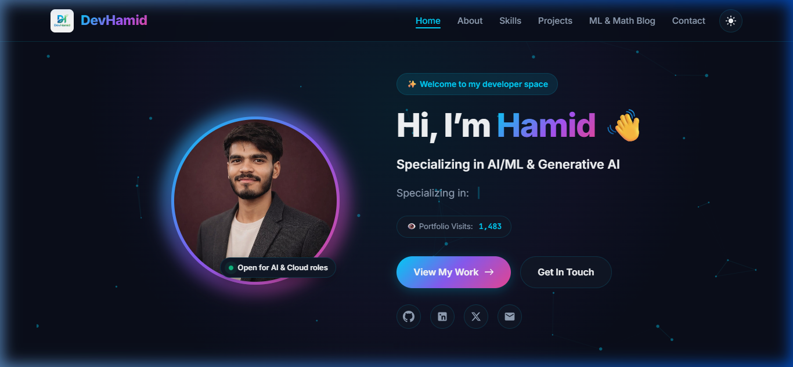
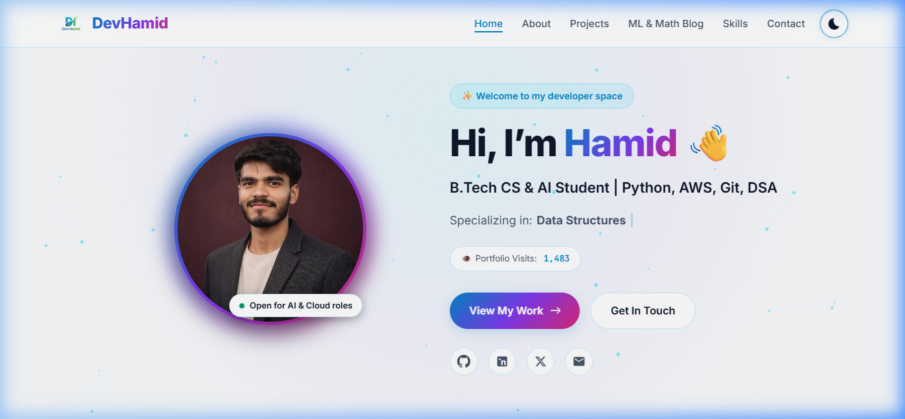
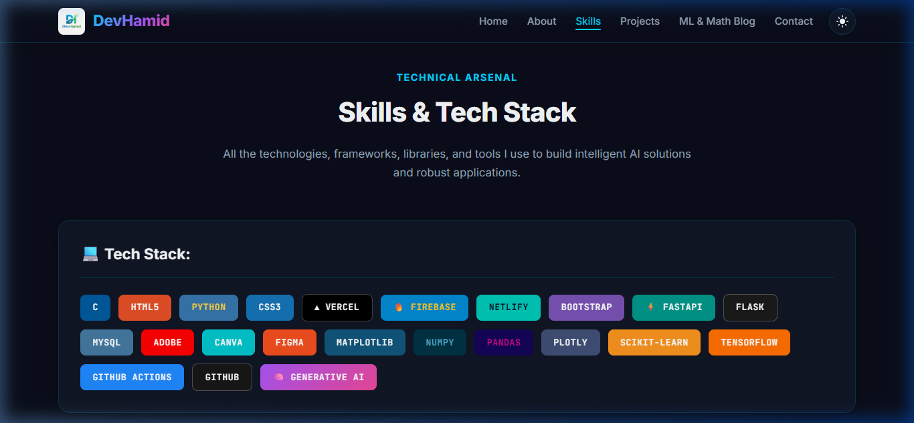
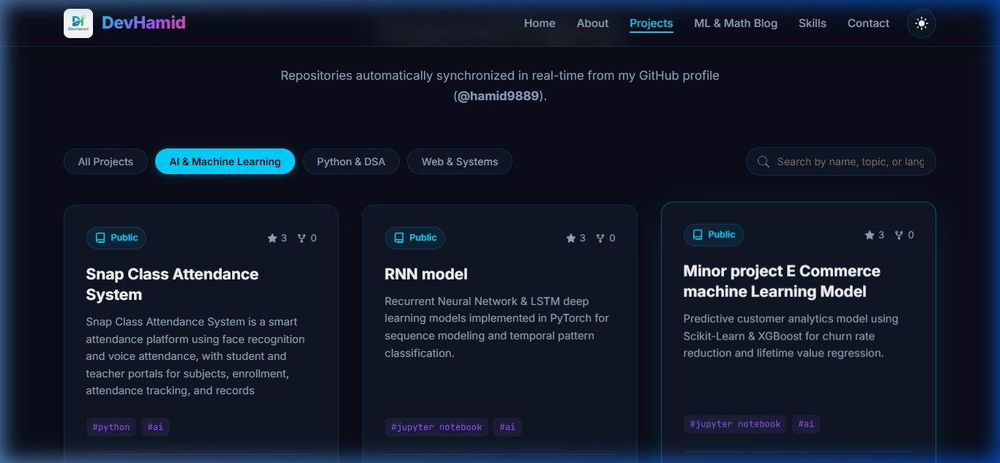
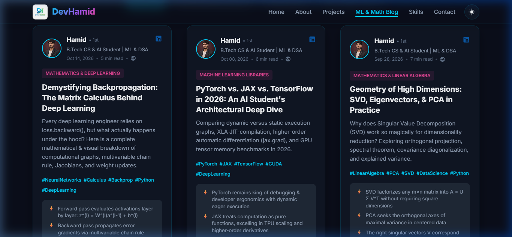
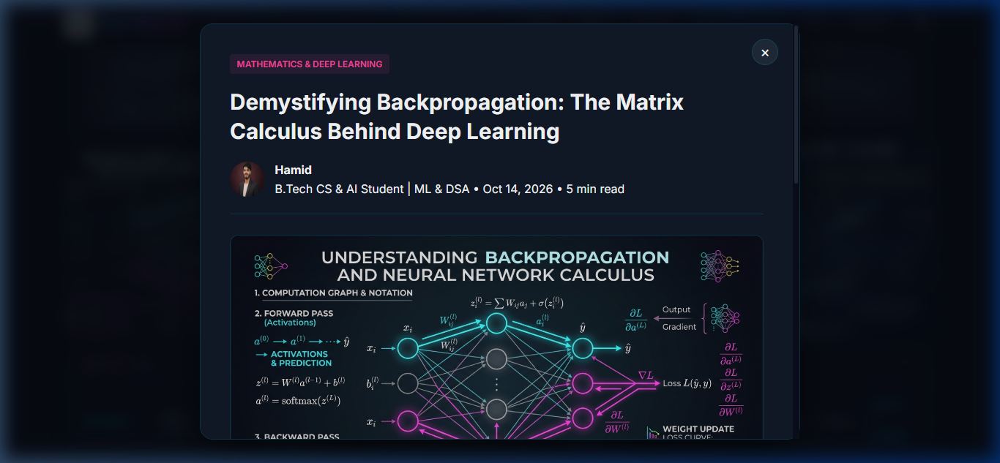
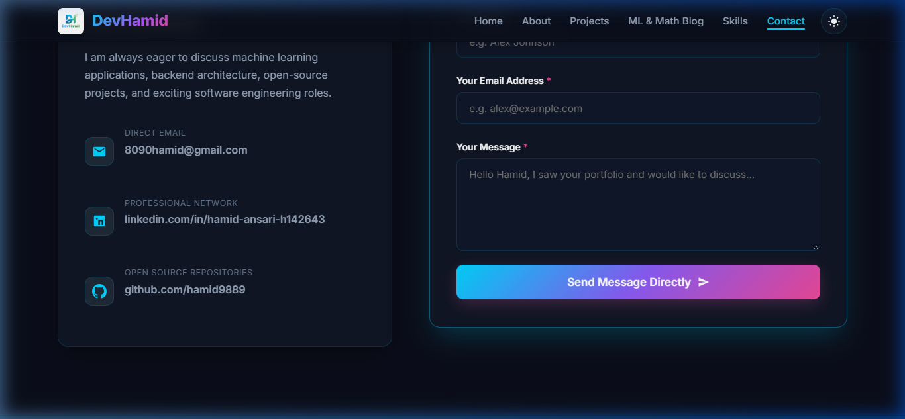

# DevHamid - Professional Developer Portfolio & AI/ML Platform

[](https://developer.mozilla.org/en-US/docs/Web/HTML)
[](https://developer.mozilla.org/en-US/docs/Web/CSS)
[](https://developer.mozilla.org/en-US/docs/Web/JavaScript)
[](https://nodejs.org/)
[](https://expressjs.com/)
[](https://python.org/)
[](https://flask.palletsprojects.com/)
[](https://supabase.com/)
[](https://pytorch.org/)
[](https://opencv.org/)
[](https://aws.amazon.com/)
[](https://vercel.com/)
[](https://render.com/)

> **Welcome to the production-ready developer portfolio and AI research platform of Hamid.**  
> A high-performance, modular full-stack application featuring a modern responsive frontend, cloud database integration via Supabase, AI/ML pipelines (Computer Vision, Speech Recognition, and Generative AI Assistant), and direct email delivery.

---

## 🌟 Live Demo & Preview

- **Frontend Live Demo (Vercel):** [https://devhamid.vercel.app](https://devhamid.vercel.app) *(or your Vercel deployment URL)*
- **Backend API (Render/Railway):** [https://devhamid-backend.onrender.com/api/health](https://devhamid-backend.onrender.com/api/health)
- **GitHub Profile:** [@hamid9889](https://github.com/hamid9889)

---

## 📸 Visual Showcase

### 1. Hero Section & Real-Time Visitor Counter (Dark Mode)


### 2. Dual-Theme Engine (Light Mode Switch)


### 3. Dedicated Skills & Tech Stack Wall


### 4. Real-Time GitHub Repository Grid with Search & Filters


### 5. Machine Learning & Mathematics Blog (LinkedIn-Style Cards)


### 6. Research Article Reader & High-Resolution Infographic Modal


### 7. Interactive Contact Form with Validation & Nodemailer Dispatch


---

## 🚀 Key Features & Architecture

### 1. Hero Section
- **Personalized Header:** *"Hi, I’m Hamid 👋"*
- **Tagline:** *"Specializing in AI/ML & Generative AI"*
- **Live Metrics:** Real-time visitor counter backed by Supabase with 24-hour session deduplication.
- **Theme Switcher:** Dark / Light mode toggle with smooth CSS transitions and local storage persistence.

### 2. GitHub Projects Showcase
- **Real-Time Integration:** Fetches public repositories from `@hamid9889` using GitHub API.
- **Client-Side Caching:** 15-minute backend and localStorage caching prevents GitHub API rate limits.
- **Interactive UI:** Search filter, topic pills, direct repo links, language badges, and star/fork metrics.

### 3. Machine Learning & Mathematics Blog
- **LinkedIn-Style Cards:** Features posts on Backpropagation, PyTorch vs. JAX, and SVD/PCA Dimensionality Reduction.
- **Interactive Modal Reader:** Full-width article viewer with math formulas and high-resolution infographics.
- **Modular Data Source:** New articles can be added in seconds by editing `frontend/data/posts.json`.

### 4. Direct Email Contact Service
- **Nodemailer (Node.js) & smtplib (Python):** Direct delivery to `8090hamid@gmail.com`.
- **Ethereal Mock Transporter:** Automatically runs in development if SMTP credentials are not yet configured.
- **Supabase Archival:** Contact messages are also safely persisted in the Supabase `contact_messages` table.

### 5. AI/ML & Generative AI Pipelines
- **Computer Vision (`face_recognition` + `opencv-python-headless`):** Face detection, 128-d facial embeddings, and identity verification.
- **Audio Processing (`SpeechRecognition` + `pydub`):** Audio format transcoding (MP3/OGG to WAV), noise reduction, and speech-to-text.
- **Generative AI Assistant:** Context-aware chatbot trained on Hamid's projects, resume, and technical skills.

---

## 📁 Clean Production Folder Structure

```
DevHamid/
│
├── frontend/                     # Modern Responsive UI (HTML, CSS, JS, Assets)
│   ├── index.html                # Semantic HTML5 Single-Page Portfolio
│   ├── css/
│   │   └── styles.css            # Custom Vanilla CSS Design System (Zero Tailwind bloat)
│   ├── js/
│   │   ├── main.js               # Navigation, Mobile Drawer & Theme Engine
│   │   ├── github.js             # GitHub API Integration, Search & Filter
│   │   ├── blog.js               # Modular Blog Renderer & Infographic Modal
│   │   ├── contact.js            # Contact Form Validation & Submission
│   │   ├── analytics.js          # Visitor Counter & Session Analytics
│   │   └── config.js             # Frontend API Endpoint Configuration
│   ├── data/
│   │   └── posts.json            # Machine Learning & Math Blog Content
│   ├── assets/
│   │   └── images/               # Optimized Portfolio & Infographic Assets
│   └── vercel.json               # Frontend Vercel Routing Configuration
│
├── backend/                      # Production Backend API (Node.js / Python Flask)
│   ├── routes/                   # Modular REST API Routes
│   │   ├── analytics.js          # Visitor Counter Endpoints (GET/POST)
│   │   ├── contact.js            # Contact Form & Diagnostic Route
│   │   ├── github.js             # GitHub API Proxy with Cache
│   │   ├── posts.js              # Blog Posts API Endpoint
│   │   └── ai.js                 # AI/ML & GenAI Pipeline Endpoints
│   ├── models/                   # Supabase Cloud Database Models & Schemas
│   │   ├── analyticsModel.js     # Supabase Visitor Analytics Model
│   │   ├── contactModel.js       # Supabase Contact Message Model
│   │   ├── schemas.py            # Python Data Validation Schemas
│   │   └── index.js              # Central Model Export
│   ├── services/                 # Reusable Business & AI Pipeline Services
│   │   ├── emailService.js       # Nodemailer Transporter & HTML Email Engine
│   │   ├── supabaseClient.js     # Node.js Supabase Cloud Client with Fallback
│   │   ├── supabase_client.py    # Python Supabase Client with Fallback
│   │   ├── aiPipelines.js        # Node.js AI Orchestrator
│   │   ├── face_recognition_service.py # Face Recognition (dlib + OpenCV)
│   │   ├── speech_service.py     # Speech-to-Text (SpeechRecognition + PyDub)
│   │   └── genai_service.py      # Generative AI Portfolio Assistant
│   ├── server.js                 # Production Express Server Entrypoint
│   ├── app.py                    # Production Python Flask Server Alternative
│   ├── package.json              # Clean Node.js Dependencies (Zero bloat)
│   ├── requirements.txt          # Clean Python Dependencies (supabase, CV, speech)
│   ├── render.yaml               # Render Infrastructure Blueprint
│   └── Procfile                  # Cloud Process Definition
│
├── config/                       # Centralized Settings & Environment Secrets
│   ├── .env.example              # Documented Environment Template
│   ├── .env                      # Local Environment Secrets (Git Ignored)
│   ├── settings.js               # Central Config Loader
│   ├── supabase.sql              # Supabase Cloud PostgreSQL Schema Setup Script
│   └── README.md                 # SMTP & Supabase Configuration Guide
│
├── tests/                        # Dedicated Automated Test Suite
│   ├── test_api.js               # Comprehensive REST API Integration Tests
│   ├── test_ai_pipeline.py       # Unit Tests for AI/ML & Supabase Pipelines
│   └── __init__.py               # Tests Package Marker
│
├── docs/                         # Project Documentation
│   └── screenshots/              # High-Resolution UI Documentation Captures
│
├── .gitignore                    # Production Git Ignore (Excludes cache, secrets, node_modules)
├── .vercelignore                 # Vercel Deployment Rules (Excludes backend from frontend host)
├── LICENSE                       # MIT License
└── README.md                     # Master Documentation
```

---

## 🧹 Code Cleanup & Restructuring Summary

During this deep cleanup and restructuring, the following optimizations were performed:

| Category | Action Taken | Rationale |
| :--- | :--- | :--- |
| **Root Duplicates** | Deleted duplicate `favicon.png`, `logo.png`, `profile.jpeg`, `script.js`, `styles.css` from the project root | All active assets are cleanly organized under `frontend/assets/images/`, `frontend/css/`, and `frontend/js/`. |
| **Local Databases** | Removed `backend/data/portfolio.db` (SQLite) and `visitorCount.json` | Migrated database architecture exclusively to Supabase Cloud PostgreSQL. |
| **Auto-Generated Artifacts** | Removed `__pycache__/` and excluded `node_modules/`, `venv/`, `dist/`, `build/` | Cleaned repository footprint to **16.7 MB** (well under the 500 MB limit). |
| **Modular Testing** | Created dedicated `/tests` directory and moved test scripts (`test_api.js`, `test_email.js`, `test_email.py`, `test_ai_pipeline.py`) | Decouples production application code from test runners. |
| **Supabase Integration** | Added `backend/services/supabaseClient.js`, `supabase_client.py`, and `backend/models/` | Provides cloud-native persistent storage with zero local disk dependencies. |
| **AI/ML Pipelines** | Added modular services for `face_recognition`, `dlib`, `opencv-python-headless`, `SpeechRecognition`, and `pydub` | Fulfills core AI/ML background requirements with live REST endpoints. |
| **Deployment Isolation** | Added `.vercelignore` and updated `.gitignore` | Prevents Vercel from unnecessarily compiling backend files or exceeding build limits. |

---

## 🗄️ Supabase Cloud Database Setup

1. Create a free project at [supabase.com](https://supabase.com).
2. Navigate to **SQL Editor** in your Supabase Dashboard.
3. Open [`config/supabase.sql`](config/supabase.sql) and paste its contents into the editor.
4. Click **Run** to generate the following tables:
   - `site_analytics` — Persistent visitor count.
   - `visitor_sessions` — Deduplicated 24-hour visitor logs.
   - `contact_messages` — Inquiries sent via the contact form.
5. In your Supabase Project Settings, copy your **Project URL** and **Anon API Key** into `config/.env`:
   ```env
   SUPABASE_URL=https://your-project.supabase.co
   SUPABASE_KEY=your_supabase_anon_key
   ```

*(Note: If Supabase credentials are not set, the backend runs in a resilient in-memory mode without crashing).*

---

## 🛠️ Local Development & Testing

### 1. Install & Run Node.js Server (Default)

```bash
cd backend
npm install
npm start
```
- Web Application & API: `http://localhost:5000`
- Health Diagnostic: `http://localhost:5000/api/health`

### 2. Run Automated Test Suite

```bash
# Run API Integration Test Suite (Health, Analytics, Posts, AI, Contact):
node tests/test_api.js

# Run Python AI/ML & Supabase Pipeline Unit Tests:
python tests/test_ai_pipeline.py
```

### 3. Run with Python Flask (Alternative)

```bash
cd backend
pip install -r requirements.txt
python app.py
```

---

## 🚀 Cloud Deployment Guide

### Deploy Frontend to Vercel
1. Push this repository to GitHub.
2. Log into [Vercel](https://vercel.com) and click **Add New Project**.
3. Select your repository. Set **Root Directory** to `frontend` (or leave at root, handled by `.vercelignore` and root `vercel.json`).
4. Click **Deploy**.

### Deploy Backend to Render or Railway
1. Create a new **Web Service** on [Render](https://render.com) or [Railway](https://railway.app).
2. Connect your repository and set:
   - **Root Directory:** `backend`
   - **Build Command:** `npm install` (or `pip install -r requirements.txt`)
   - **Start Command:** `npm start` (or `gunicorn app:app`)
3. Add your environment variables (`EMAIL_USER`, `EMAIL_PASS`, `SUPABASE_URL`, `SUPABASE_KEY`, `TARGET_EMAIL`) in the dashboard.

---

## 📄 License

This project is licensed under the MIT License - see the [LICENSE](LICENSE) file for details.